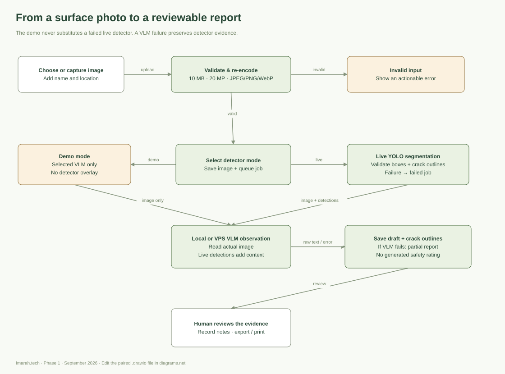

# Phase 1 — September 2026

For a short numbered update, read [current progress and upcoming work](Progress.md).

Our September goal is to make the proposal understandable through a working prototype. A visitor should be able to see the complete inspection journey, compare local model outputs, and understand what we will develop next.

## A note about the supplied file

When implementation began on 19 September, this file contained **zero bytes on disk**. The request referred to trained YOLO endpoints and a flow here, but neither was available in the saved file. No endpoint URL or key was guessed. If those details were in an unsaved editor buffer, save them separately before replacing that buffer with this updated document.

## The working flow

1. Choose a sample, upload a photo, or open the phone's camera picker.
2. Give the inspection a name and add location or field notes if useful.
3. Choose an available VLM and the detector mode. Qwen 4B has separate Local and VPS options.
4. In live mode, call the configured trained YOLO endpoint and validate its result.
5. Let the selected VLM read the image. Live detector boxes are extra context, not ground truth.
6. Save the photograph, raw model observation, model settings, timing, and a report draft.
7. A person reviews the evidence and adds their own notes. Export JSON or print/save the report as PDF.

In demo mode, the VLM still runs on the actual selected image, without a detector overlay. Historical synthetic fixtures may contain illustrative box metadata, but the interface does not draw it. Uploaded images do not receive made-up detections. If the model fails, the app says so.

## Trained detector connection

The Ultralytics Platform deployment URL was supplied on 20 September. Its prediction route is now configured in the local `.env`. The service reports healthy, and its own API specification confirms Bearer authentication; a request without a key returned 401. The adapter was updated to match this dedicated deployment's contract.

After the key was supplied, authenticated image requests succeeded and the app completed a live inspection. The wall photo returned three overlapping `crack` regions; the synthetic intact control returned none. The service reports a segmentation model with class 0 named `crack`. Reports display only its actual segmentation outlines in blue. The box-view option and automatic box fallback have been removed at the team’s request. The first adapter had discarded the outlines; that integration gap is fixed, including verified restoration for three existing reports. Read the [saved findings](../docs/evaluation/yolo-findings.md), [segmentation guide](../docs/guides/segmentation.md) and [request contract](../docs/architecture/api.md). These checks establish a working integration, not model accuracy.

## Model experiments

The original VLM shortlist is preserved in [the supplied DOCX](<FYP VLM List & Download Commands.docx>). This machine has a CPU and about 31 GiB usable RAM. The first build had very little free disk space, so it used SmolVLM 256M and 500M as practical baselines.

After space was freed, we continued with Qwen3-VL 2B and 4B through a verified, project-local Ollama runtime. The [local Qwen guide](../docs/guides/local-qwen.md) explains setup and the separate model folder. The app only enables a downloaded tag whose recorded digest matches. Read the saved experiments for completed inference results; an installed runtime or registry entry alone is not a benchmark.

The model lab keeps the original four-image comparison and a new, attributed interior-wall photograph as separate choices. It shows actual per-runtime settings and leaves unavailable memory measurements blank. SmolVLM2, InternVL and the larger Qwen2.5-VL remain later comparison candidates.

The continuation completed 35 new benchmark rows, bringing the notebook to **62 completed rows across four models**. The repeated comparison measured medians of 11.417 seconds for SmolVLM 256M, 118.388 seconds for Qwen 2B and 175.129 seconds for Qwen 4B on this CPU. On the separate wall photo, 4B gave the most useful visible description, while 2B suggested a structural issue without enough evidence. These small examples do not establish an accuracy score or a final model winner. The saved **Interior wall · Qwen3-VL 4B** inspection is ready for the team's review.

Read the [benchmark method](../docs/evaluation/benchmark-method.md), [results](../docs/evaluation/model-findings.md), and [phase log](../docs/phases/01-september-2026.md). The app's **Model lab** displays the actual saved runs.

## Qwen on the VPS

Only Qwen3-VL 4B Instruct Q4_K_M is installed on the DatabaseMart VPS, under `/sdb-disk/AIML-Models/VLM-models/qwen3-vl-4b-instruct-q4_k_m/`. Its image API is reached from the PC through an SSH tunnel. It runs on the Tesla P100 using the tested Ollama 0.20.0 runtime; the model files passed their checksums and real image inference succeeded. Follow the [connection guide](../docs/guides/vps-qwen.md), [server storage rules](../docs/operations/server-environment.md) and [actual verification](../docs/evaluation/vps-qwen-check.json). The website now offers **Qwen 4B · Local** and **Qwen 4B · VPS** separately in inspections and Model lab. The VPS choice needs the tunnel and never falls back to the local copy. Existing local model IDs and saved benchmarks remain unchanged; new VPS rows have their own model ID and execution details.

## The rest of the proposal

Construction management, sensor monitoring, and urban analysis have interactive concept screens with fictional data. Their delivery stages follow the proposal: Module 1 in October–December 2026, Module 2 in January–February 2027, monitoring in March–April, and urban analysis plus final evaluation in April–May.

The September demonstration is early foundation work, not a claim that the later modules are complete.
