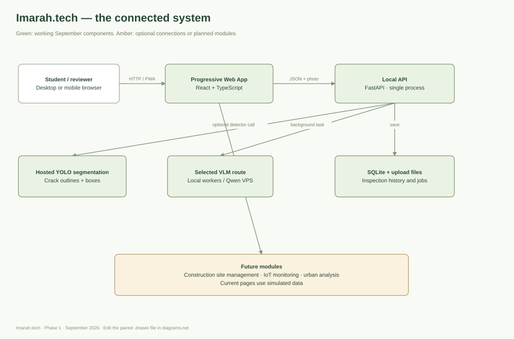

# Imarah.tech

**A student-built workspace for building inspection and construction research.**

Imarah brings a surface photograph, crack-detection evidence, a local vision-language model, and a person's review into one record. The September 2026 prototype also demonstrates where site management, building monitoring, and urban analysis will fit.

This project follows the [FYP proposal](<FYP-I-project-proposal-2026-final (1).pdf>). We are building it in stages, with plain documentation and code the team can explain in an evaluation.



## Open the app

On the prepared development machine:

```bash
cd /home/it-admin/FYP-Imarah
.venv/bin/python scripts/start.py
```

Visit **http://127.0.0.1:8000**. Keep that terminal open. If a server is already running there, simply open the address; do not start a second copy.

For a fresh installation, use the [setup guide](docs/guides/setup.md). The API documentation is at [localhost:8000/docs](http://127.0.0.1:8000/docs).

Qwen 4B has separate **Local** and **VPS** choices in the website. Follow the [PC connection guide](docs/guides/vps-qwen.md) to open the SSH tunnel for the VPS choice. The [server environment](docs/operations/server-environment.md) records the default hardware and storage rules. Each choice keeps its own results; earlier local benchmarks are preserved.

## What works in Phase 1

- Responsive React PWA with desktop and mobile navigation, an install manifest, and an offline app shell.
- Image upload, a device-camera file input, and clearly labelled research/synthetic samples.
- Image validation, local history, background model jobs, and recovery messages after a restart.
- Local SmolVLM and Qwen3-VL inference, saved raw observations, human review notes, JSON exports, and printable reports.
- Reproducible model comparisons with input hashes, pinned revisions/digests, measured time, available memory measurements, and unedited outputs.
- A connected hosted YOLO crack detector, verified with authenticated images and a complete inspection. Reports display only its blue segmentation outlines; no bounding-box overlay or fallback is used. See the [actual findings](docs/evaluation/yolo-findings.md) and [connection guide](docs/guides/yolo-endpoint.md).
- Interactive, explicitly simulated previews for workforce/PPE, attendance, salary and insurance records, materials, sensors, weather context, and urban indicators.
- A proposal-aligned roadmap and editable draw.io diagrams.

The app never treats an image as proof of structural safety. The model's words remain visible even when they are wrong. Review notes do not overwrite those words.

## Start here for the evaluation

1. Read the [five-minute demonstration guide](docs/guides/evaluation-demo.md).
2. Open **Model lab** to inspect the saved experiments, then **Inspections** for the complete report journey.
3. Use **Project roadmap** to distinguish the September work from the later modules.
4. Check the [handover](docs/guides/handover.md) for the few remaining inputs.

The [Phase 1 note](Extra-Documentations/Phase1.md) explains the implemented flow, completed model experiments and verified detector connection.

## Repository map

| Folder | Purpose |
| --- | --- |
| `frontend/` | React and TypeScript interface, PWA assets, styles |
| `backend/app/` | FastAPI routes, SQLite access, detector and VLM services |
| `backend/tests/` | Behaviour tests using temporary records and a fake inference worker |
| `scripts/` | Start the app, download models, run experiments, make diagrams |
| `deploy/qwen_vps/` | Dedicated VPS image API, service units and model-folder documentation |
| `models/` | Small model registry; downloaded weights are ignored by Git |
| `benchmarks/fixtures/` | Small, attributed research images and synthetic controls |
| `benchmarks/results/` | Real experiment outputs that can be versioned |
| `data/` | Local database and uploaded images; ignored by Git |
| `docs/` | Requirements, architecture, phases, evaluation and practical guides |
| `diagrams/` | Editable `.drawio` files with viewable `.svg` companions |
| `Extra-Documentations/` | The team's original supporting material |

## Check the work

```bash
PYTEST_DISABLE_PLUGIN_AUTOLOAD=1 .venv/bin/python -m pytest -q
cd frontend
npm run build
```

With the server running, `python scripts/browser_smoke.py` checks desktop/mobile flows. `python scripts/run_benchmark.py` performs real local model inference; it takes longer than the API tests. See [testing](docs/evaluation/testing.md) and the [documentation index](docs/README.md).

The [local Qwen guide](docs/guides/local-qwen.md) covers the project model server, verified downloads and repeating the larger-model comparison. Keep the saved [model findings](docs/evaluation/model-findings.md) handy for the evaluation: timing and model mistakes are both part of the result.

© 2026 Imarah.tech. All rights reserved for original project work. Third-party packages, models, fonts, and research images retain their own terms; see [attribution](docs/attribution.md).
