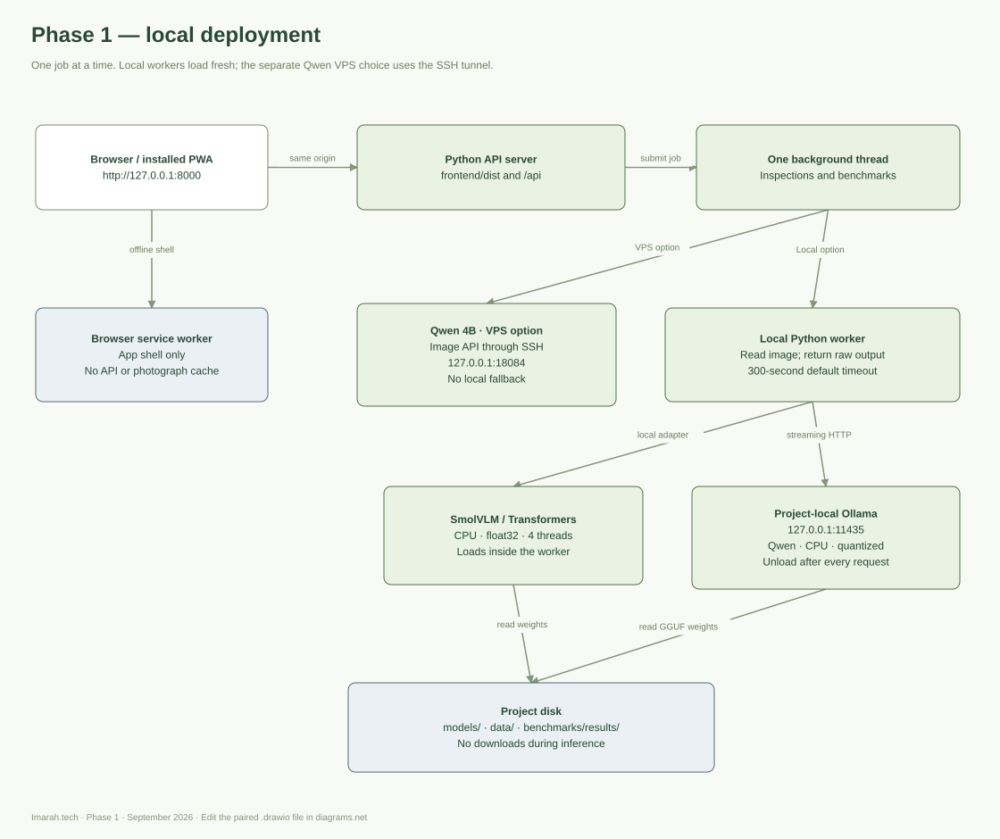
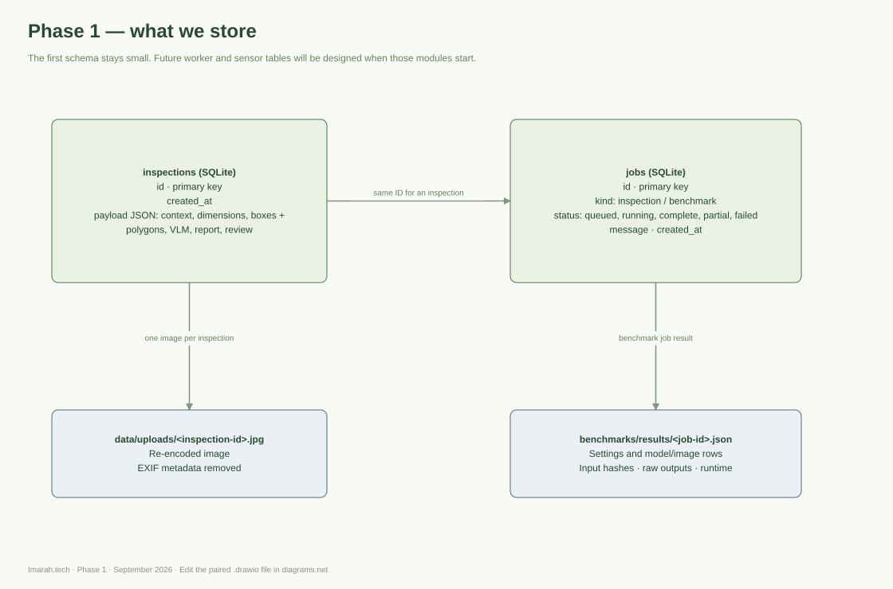

# How the application fits together

We chose a small structure: a React interface, one Python API, SQLite for local records, and separate functions for image handling, detection and VLM inference. The proposal has a large eventual scope; the first implementation does not need microservices to explain that scope.

## The browser

`frontend/src/App.tsx` owns navigation. Each page calls the API through `api.ts`; `types.ts` describes the records it expects. We use React state for form inputs and a small polling hook for jobs. No global state library is needed yet.

The build produces `frontend/dist`. FastAPI serves that directory and the API on the same origin, which avoids a separate production frontend server and unnecessary cross-origin configuration. Vite proxies `/api`, `/samples` and `/uploads` while developing.

The manifest and service worker support PWA installation and a cached interface shell. They do not store offline inspection submissions or cache private photos/API results. A user needs the local server for history, model inference and review saves. The camera is a standard file input with `capture="environment"`; the exact picker depends on the browser/device.

## The API and jobs

`main.py` handles HTTP input and response codes. `database.py` holds the SQLite operations. Services in `services/` do the actual image, detector, VLM and benchmark work.

Submitting an inspection returns HTTP 202 with an ID. The image and queued record are saved before the job starts. A single `ThreadPoolExecutor` thread runs long tasks in order. Local VLM runs launch `scripts/vlm_worker.py` as a child process. SmolVLM loads inside that process. Local Qwen uses a streaming request to the local Ollama server; completed requests explicitly unload their model. The outer timeout stops a local worker and closes its connection.

Qwen 4B also has a separate VPS registry entry. `remote_qwen.py` checks the dedicated image API through the SSH tunnel, validates its model identity and sends the photograph and prompt. It saves the actual answer and execution details without calling a local worker. Its HTTP timeout and upstream errors become visible job failures or partial reports. The Local and VPS entries share pinned weights but have different IDs, so old local benchmarks keep their meaning. The [VPS connection diagram](../../diagrams/architecture/vps-qwen.svg) shows that route.

This design intentionally runs **one API process and one model job at a time**. SQLite stores the job state, but the queue itself is in memory. On restart, unfinished records are marked failed/interrupted with a message; they are not secretly resumed. A durable queue becomes useful when we add multi-user deployment.

## Evidence and reporting

The detector adapter accepts supported JSON box formats and Ultralytics segmentation outlines, checking confidence, finite coordinates, matching x/y lists and image bounds. It stores each available outline as an optional `polygon` beside its box. The inference input is the stored, re-encoded image; all coordinates refer to that image's pixels. The report draws the original outline points in a matching SVG viewBox, without smoothing or inventing a mask. In live mode, the VLM receives the image and concise detector boxes; the potentially thousands of polygon points are saved for display/export and excluded from its text prompt. In demo mode, the VLM receives the image without illustrative annotations as prompt evidence.

SmolVLM's image processor uses one 512×512 view with splitting disabled. Qwen receives an aspect-preserving 512-pixel thumbnail and uses Ollama's native vision processing. Detector coordinates still refer to the saved image dimensions, not either VLM view; they are textual context, not a pixel-accurate VLM overlay. Results preserve the preprocessing version and the available tensor shape or transmitted-image dimensions/hash.

The report combines four visible sources:

1. **Detector evidence:** only saved live segmentation outlines are drawn. Old box-only records remain readable but show no overlay and explain the missing outlines. Demo mode shows the unannotated photograph.
2. **VLM observation:** the raw generated text, with model and runtime details.
3. **Application guidance:** a fixed follow-up checklist and limitation statement.
4. **Reviewer notes:** self-entered human interpretation and timestamp.

The model does not author a structural certificate. We also do not assign a severity grade from crack pixels, confidence, or a sensor reading. Reviewer identity is not verified in this local prototype.

## Storage

| Location | Contents | Why |
| --- | --- | --- |
| `data/imarah.db` | `inspections` and `jobs` tables | Simple local persistence without running a database server |
| `inspections.payload` | JSON snapshot of context, dimensions, detections, VLM and review | Easy to inspect while the Phase 1 report shape is still developing |
| `data/uploads/<id>.jpg` | Cleaned photo | Avoid user-controlled filenames and remove EXIF metadata |
| `benchmarks/results/<job-id>.json` | Experiment settings and rows | Raw results can travel with the research documentation |
| `models/<model-id>/` | Downloaded weights, processor files, `READY` marker | Reuse downloads and keep inference offline |
| `models/ollama/` | Ollama manifests and verified model blobs | Keep the project's quantized models separate from system models |
| `.runtime/ollama/` | Project-local Ollama executable and CPU libraries | Reproduce the local runtime without replacing a system installation |

The SQLite JSON snapshot is a prototype choice. Search is currently browser-side over the most recent 200 inspections. We will use explicit relational tables, migrations, pagination, and proper access controls when Module 2 introduces people and operational records.

## Practical limits

The default server binds to `127.0.0.1`. There is no login, permission system, multi-tenant boundary, automatic backup, verified reviewer identity or public deployment configuration. Uploaded images are accessible to anyone who can access the local server. Treat any LAN exposure as a trusted demonstration, not a deployed service.

The model registry keeps all five original shortlisted candidates visible alongside the small baselines. Ollama discovery checks the server version, installed tag and recorded digest; the worker also checks vision capability before sending an image. The [Qwen setup guide](../guides/local-qwen.md) explains the separate port, launcher and model store. The [model findings](../evaluation/model-findings.md) record which candidates have actually completed experiments.
