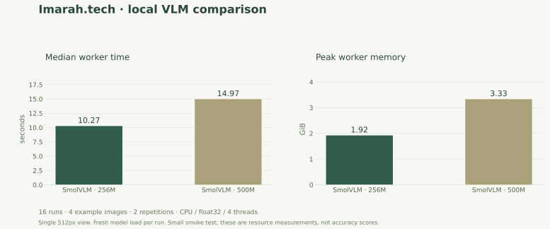

# Local VLM findings

Four local models have now completed real inference. The latest [Qwen continuation](qwen-findings.md) compares SmolVLM 256M with Qwen3-VL 2B/4B and records their actual responses and CPU timings. Keep 256M for a quick live workflow demonstration; use the larger-model outputs to examine differences and mistakes. There is no validated quality winner yet.

The first-build results below preserve the original two-model study. **SmolVLM 256M used less time and memory than 500M** on that matched four-image experiment, but neither was consistently grounded in the image. These are demonstration baselines, not reliable automated inspection models.

## Main comparison: the same four images, twice

Experiment: [bench-08477720b9e3.json](../../benchmarks/results/bench-08477720b9e3.json). All **16 of 16 runs completed** on 19 September 2026.

| Model | Runs | Median worker time | Observed range | Peak worker memory |
| --- | ---: | ---: | ---: | ---: |
| SmolVLM 256M | 8 | 10.269 s | 6.048–11.940 s | 1,966.5 MiB / 1.92 GiB |
| SmolVLM 500M | 8 | 14.967 s | 11.723–17.077 s | 3,411.1 MiB / 3.33 GiB |

Both models used `surface-observation-v1`, the `single-view-512-v1` processor profile, CPU float32, four threads, a 140-token limit, greedy decoding and fresh worker processes. Two repetitions produced identical text for each model/image pair in this experiment. That is an observed repeatability result, not an accuracy measurement. Background activity and thermal conditions varied, so the timing range matters.

## What the models actually said

These are qualitative observations from reading the output beside the image. They are not expert rubric scores.

| Image | SmolVLM 256M | SmolVLM 500M |
| --- | --- | --- |
| CrackForest 001: road with a largely horizontal crack | Mentioned cracks and rough texture; gave little directional detail | Mentioned cracks, but called the main direction vertical and guessed concrete |
| CrackForest 003: another cracked road surface | Mentioned cracks, crevices and coarse/fine texture | Mentioned cracks and roughness, but again guessed material and a direction |
| Generated intact texture | Reported no cracks | Invented visible horizontal cracks |
| Generated branching line/crack illustration | Missed the line, claimed no damage and guessed plastic/rubber | Claimed no visible cracks |

A bigger checkpoint did not automatically produce a better observation. The clear misses on the synthetic control also show that the faster single-view profile needs a quality study. We keep all of these responses visible in the app; no failure has been rewritten into a successful inspection.

## A shorter prompt changed the behaviour

We also ran [bench-cf006389bc28.json](../../benchmarks/results/bench-cf006389bc28.json): **8 of 8 runs completed**, using the same four images and processor settings with the `brief-caption-v2` prompt and one repetition.

The 256M model gave very short captions: it identified a road in the research photos and a black line in the synthetic crack image, but missed useful crack detail in the road captions. The 500M model described the two road photos as roads with cracks, avoiding the earlier directional claims, but missed the synthetic line. Its intact-texture description became long and speculative and reached the token limit.

That experiment is available in Model lab's run selector, and both prompt profiles can now be rerun from the interface or CLI. We did not select a final reporting prompt from this tiny set: a shorter prompt reduced some mistakes while losing useful detail elsewhere.

## Why the first runs took about 55 seconds

The first experiment, [bench-d5a46c0f5d2c.json](../../benchmarks/results/bench-d5a46c0f5d2c.json), used the official processor defaults on three images with the 256M model. Its worker times were 55.291, 54.247 and 54.300 seconds, with peak memory around 3.1 GiB. The model correctly described the real road crack, but then speculated about depth and causes and reached the token limit. It described the drawn synthetic crack as a black line.

Inspection of the processor configuration showed that it enlarged images to a 2,048-pixel longest edge and split them into tiles. Making the input photo small before calling the processor did not prevent that enlargement. We explicitly selected one 512×512 view instead. A [diagnostic run](processor-diagnostic.json) on the first road image took 6.161 seconds, using a tensor shaped `[1, 1, 3, 512, 512]`.

The change improves responsiveness, but it also changes visual detail and model output. We therefore keep the early tiled results separate and record the processor profile in every new row. The 16-run table above includes only the matched single-view experiment.

## What we would do next

1. Connect and verify the team's trained YOLO endpoint. Preserve its detections as evidence; do not ask the VLM to replace a trained crack detector.
2. Collect a held-out set of real building images with intact surfaces, different defects, lighting conditions and confusing patterns.
3. Compare single-view, tiled and detector-region inputs on the same building images. Check quality as well as latency.
4. Ask qualified reviewers to apply a consistent visual-grounding and report-quality rubric.
5. Use the completed Qwen continuation to plan a reviewed building-image study before extending to the remaining shortlist candidates. The original two baselines are from the same family; the continuation adds another family with explicit runtime/precision differences.

## An exploratory interior-wall example

The continuation adds an attributed public interior-wall photograph (`commons-wall-03`) separately from the original four-image set. A real 256M inspection took 6.350 seconds and returned: “The surface of this floor is uneven, with visible cracks and the surface texture is not uniform.”

The photograph shows a textured interior wall with a dark vertical feature beside the floor and skirting board. This output focuses on the floor and makes an unevenness claim that the photograph does not establish. That is an observation about this one response, not expert scoring or a structural assessment. The unreviewed inspection is `2d299066976340c9`; its JSON export preserves the photo's author, source, licence and conversion note. Benchmark runs use the original fixture; this inspection used the app's cleaned JPEG copy, so its timing is not mixed into benchmark aggregates.

There is no trained-detector accuracy, structural-risk score, calibrated measurement, fine-tuning result or expert-quality score in these experiments. See the [method](benchmark-method.md) and [tested environment](environment.json) for the practical limits.
