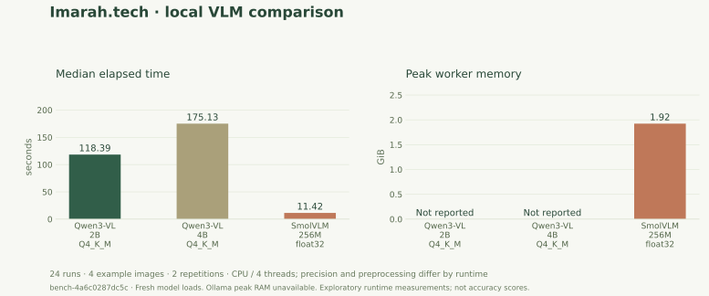

# September continuation: Qwen on the project laptop

**Completed on 20 September 2026, local time.** The freed disk space let us install and run the shortlisted Qwen3-VL 2B and 4B models alongside the original SmolVLM baselines. Both Qwen downloads passed their official layer checksums, and both ran through the real app. Runtime and model provenance are saved in [qwen-runtime.json](qwen-runtime.json).

The machine is an Intel Core i7-1355U laptop with about 31 GiB of usable RAM. These runs use its CPU, with four requested inference threads; no GPU timings are included.

The useful conclusion is practical: **keep SmolVLM 256M for a quick live workflow demonstration, and use the saved Qwen outputs to discuss richer observations and their mistakes.** Larger models took much longer on this CPU. They recognised features that the small baseline missed, but still made unsupported claims. We have not selected a validated building-inspection model.

## The repeated comparison

Experiment [bench-4a6c0287dc5c](../../benchmarks/results/bench-4a6c0287dc5c.json) completed **24 of 24 runs**: three models, the original four images, and two repetitions. There were no failed rows.

| Model and configuration | Runs | Median worker time | Observed range | Maximum measured worker RSS |
| --- | ---: | ---: | ---: | ---: |
| SmolVLM 256M · float32 | 8 | 11.417 s | 9.048–13.291 s | 1,970.3 MiB / 1.92 GiB |
| Qwen3-VL 2B · Q4_K_M | 8 | 118.388 s | 106.355–143.875 s | Not measured |
| Qwen3-VL 4B · Q4_K_M | 8 | 175.129 s | 158.034–184.576 s | Not measured |

The [machine-readable summaries](continuation-metrics.json) retain counts, timing ranges, repetition consistency and token-limit observations separately for each experiment.

Each model produced identical text across its two repetitions for each image: twelve matching pairs. That shows repeatability under these settings, not correctness. All three used the same surface-observation prompt, source images, four CPU threads and a 140-token ceiling. Every run loaded its model afresh. The default timeout was increased to 300 seconds before this comparison; some 4B runs would have exceeded the earlier 180-second limit.

SmolVLM uses a square 512-pixel view and float32 inference. Qwen uses an aspect-preserving thumbnail followed by Ollama's native vision processing, with quantized language weights. The configurations differ in several ways, so this is not an architecture-only experiment. Model groups ran sequentially on the development laptop; background load and thermal conditions were not controlled. See the [method](benchmark-method.md) before using these figures in a presentation.

Ollama does not report the model process's peak resident memory. Its HTTP client's memory would exclude the model itself, so those cells remain unavailable. A blank value is not zero RAM use.

## Reading the output beside the photograph

These are qualitative notes from inspecting the images and raw responses. They are not expert labels or accuracy scores.

| Input | SmolVLM 256M | Qwen3-VL 2B | Qwen3-VL 4B |
| --- | --- | --- | --- |
| Road 001, with a largely horizontal crack | Mentioned cracks and texture, with little directional detail | Described a diagonal direction poorly and guessed material | Described the horizontal direction more accurately, but claimed depth variations |
| Road 003, with intersecting crack features | Mentioned cracks and texture | Gave a poorly supported diagonal direction | Mentioned branching, but also gave a poorly supported diagonal direction |
| Generated intact texture | Reported no visible cracks | Reported no visible cracks | Reported no visible cracks |
| Generated branching mark | Missed the mark and guessed plastic/rubber | Described vertical and diagonal crack-like features | Described the main vertical feature and branches, but guessed concrete/plaster |

The two generated pictures are controls and illustrations. Calling the drawn mark a crack does not establish that a model can detect a real building defect. Likewise, the road photographs cannot establish building-domain accuracy. The 4B model's improved direction on one photo is useful, but its unsupported depth claim is a reason to keep review in the workflow.

## The earlier 2B checks and shorter prompt

The initial [four-image 2B check](../../benchmarks/results/bench-18ea7c91bd83.json) completed all four rows, taking 65.516–115.346 seconds. It ran during setup, under different background conditions, and is not mixed into the repeated comparison above.

The separate [brief-caption experiment](../../benchmarks/results/bench-7a7a204caa3c.json) also completed four rows, taking 131.422–144.851 seconds. The shorter prompt described the branching illustration as a line drawing, but called a road crack a “deep fissure” and guessed materials for the intact texture. Most Qwen time was spent in image/prompt processing. A shorter requested answer did not guarantee a quick response; these runs do not isolate prompt length from changing machine load.

The brief prompt remains an exploratory option. Inspection drafts continue to use `surface-observation-v1`, and the raw output stays visible even when it violates the prompt's instruction to avoid unsupported details.

## A real interior-wall example

The separate [wall comparison](../../benchmarks/results/bench-b5071a050702.json) completed **3 of 3 runs** on `commons-wall-03`, a photograph by Almanta under CC BY-SA 4.0. It is one public example, not a held-out evaluation set. Its [source and licence](../../benchmarks/fixtures/SOURCES.md) stay with the image.

| Model | Worker time | Observation from this one response |
| --- | ---: | --- |
| SmolVLM 256M | 9.615 s | Focused on an uneven floor rather than the wall; the unevenness claim was not established |
| Qwen3-VL 2B | 100.432 s | Identified the wall and vertical feature, then suggested a possible structural issue from the photograph alone |
| Qwen3-VL 4B | 161.935 s | Described the textured wall, vertical crack, baseboard and wood-grain appearance of the floor, without a structural-safety claim |

**4B gave the most useful visible description on this particular wall example.** That is a reason to keep it as a candidate for reviewed reports, not to declare it the best model for buildings. The 2B output's structural suggestion goes beyond the evidence and violates the intended reporting boundary. We keep that response unchanged so the limitation is visible.

The app also has a completed, unreviewed 4B inspection of this photograph: `74fdaf7ed0e94b69`, titled **Interior wall · Qwen3-VL 4B**. Its worker took 167.317 seconds and described the wall, vertical feature, baseboard and floor without a structural-safety claim. Inspections use a cleaned, resized JPEG; this benchmark used the original fixture. Their image-processing paths and timings are kept separate. No trained YOLO detections, crack measurements or engineer assessments were supplied for either.

## What this changes for the evaluation

Use the saved repeated comparison in Model lab to show the same image beside different model responses. Start a 256M inspection for a short live demonstration, or allow a few minutes for Qwen while showing another screen. The original [SmolVLM 256M/500M study](model-findings.md) remains available as an earlier experiment.

Across the continuation, **35 new benchmark rows completed**: four initial 2B checks, four brief captions, twenty-four repeated comparisons and three wall-photo runs. Together with the first build's 27 rows, the notebook contains **62 completed rows across four models**. These different experiments are not pooled into one timing or quality score.

The next research step is a reviewed building-image set with intact surfaces, real defects and confusing patterns. Compare quality and runtime together, then investigate image-detail settings and detector-region inputs. Connecting the team's trained YOLO endpoint remains separate work; none of these VLM runs measures that detector's accuracy.
